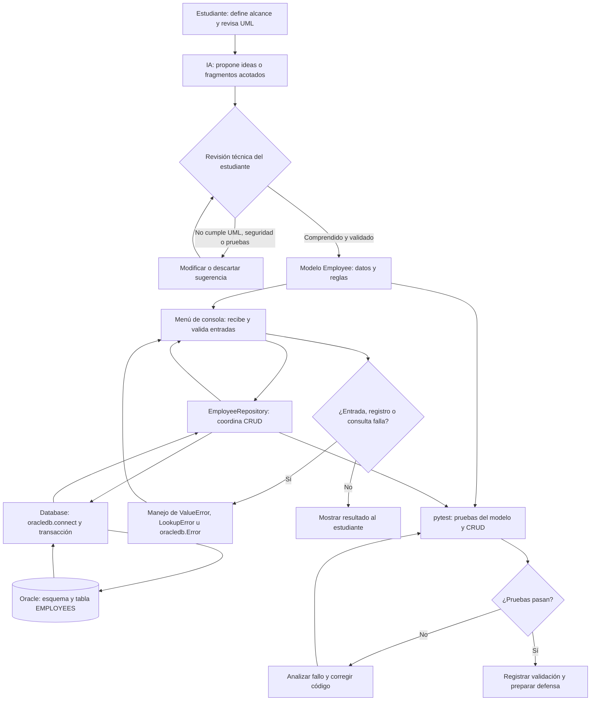
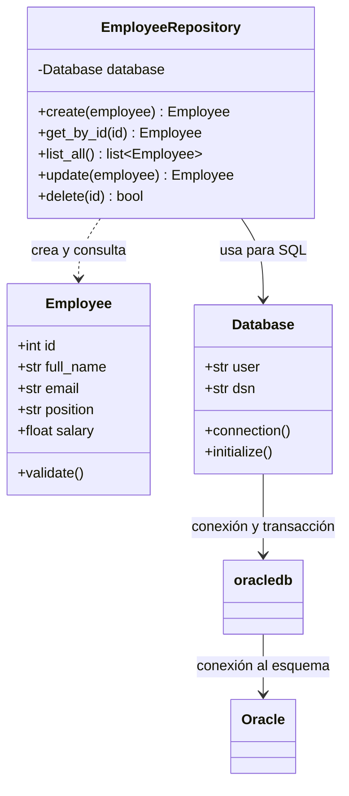

# Diagrama de flujo y relación de componentes

## Por qué se relacionan así

- **El estudiante y la IA** se conectan mediante revisión: la IA puede acelerar
  propuestas, pero el estudiante compara con el UML, verifica pruebas y decide.
  Así se satisface el uso crítico de IA sin delegar la comprensión.
- **El modelo `Employee`** contiene los datos del dominio y sus reglas de
  validación; tanto el menú como el repositorio usan esa misma representación.
- **El menú** recoge datos y comunica resultados; el **repositorio** separa el
  CRUD de la interfaz y expresa las consultas de almacenamiento.
- **El repositorio** usa `Database`, que administra conexiones y transacciones;
  esta capa utiliza `oracledb` para guardar los datos en **Oracle Database**.
- **Las excepciones** vuelven desde validación o almacenamiento al menú, que
  informa el problema y permite continuar en vez de finalizar abruptamente.
- **pytest** prueba modelo y repositorio de manera aislada con una base
  temporal. Los resultados orientan correcciones antes de la defensa.
- **`requirements.txt`** instala `oracledb`, `python-dotenv` y `pytest`.
  `oracledb` es el driver oficial; `python-dotenv` carga las credenciales
  locales y pytest ejecuta pruebas sin conectarse a Oracle.

## Diagrama de clases propuesto

Las credenciales y el DSN se leen desde `.env`, excluido del repositorio. El
archivo `.env.example` documenta los nombres de las variables sin contener
secretos.
